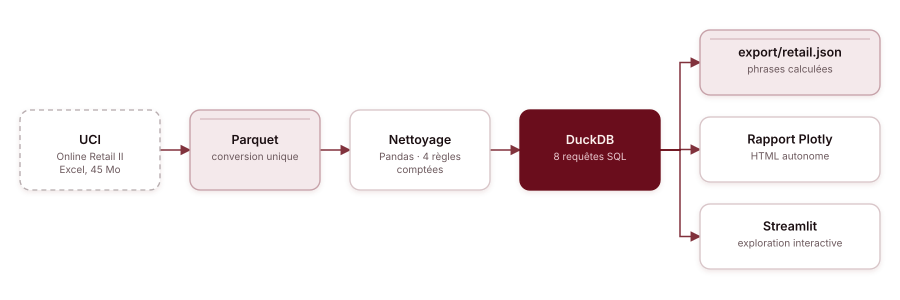

# Retail Analytics

**Deux ans de ventes réelles d'une boutique en ligne, transformées en réponses simples : quand vend-on, à qui, quoi, et qui est en train de partir ?**

Ce projet part d'un vrai fichier de ventes, avec ses défauts, et en tire ce
qu'un dirigeant ou un responsable marketing a besoin de savoir, sous une forme
que tout le monde peut lire. Les résultats sont en ligne sur
[falakion.com/da](https://falakion.com/fr/da).



## Les données

[Online Retail II](https://doi.org/10.24432/C5CG6D) est un jeu de données public
(UCI, licence CC BY 4.0) : plus d'un million de lignes de factures d'un
e-commerçant britannique d'objets de décoration et de cadeaux, de décembre 2009
à décembre 2011, avec des clients dans 43 pays.

Comme toutes les données d'entreprise, il est sale : lignes en double,
commandes annulées, frais de port mélangés aux produits, prix à zéro, clients
non identifiés.

## Ce que disent les ventes

- **Tout se joue en fin d'année.** De septembre à décembre, la boutique fait
  44 % de son chiffre d'affaires de l'année ; novembre à lui seul en pèse 15 %.
  Les stocks et la logistique doivent être prêts dès l'été.
- **Peu de produits font l'essentiel.** 21 % des références font 80 % des ventes.
- **Peu de clients aussi.** Les meilleurs clients, ceux qui achètent souvent et
  récemment, sont 24 % de la clientèle et rapportent 68 % du chiffre d'affaires.
- **La fidélisation est le vrai levier.** Seuls 20 % des nouveaux clients
  reviennent le mois suivant leur premier achat.
- **Certains produits s'achètent ensemble.** Les variantes de couleur d'un même
  article (assiettes, gants de jardin) sont dans le même panier jusqu'à 137 fois
  plus souvent que le hasard : une offre « lot » s'impose.
- **Le samedi n'existe presque pas** : 30 commandes en deux ans. Le jeudi est
  le jour le plus chargé.

Ces phrases ne sont pas écrites à la main : le code les produit à partir des
chiffres. Si une règle de nettoyage change, le texte suit.

## Un nettoyage qu'on peut justifier

Un chiffre d'affaires qui change de 10 % selon qu'on garde ou non les frais de
port doit pouvoir s'expliquer. Chaque règle est appliquée dans l'ordre, et on
compte ce qu'elle retire :

| Règle | Lignes retirées |
|---|---:|
| lignes en double | 34 335 |
| factures d'annulation (gardées à part pour mesurer les retours) | 19 104 |
| frais de port et opérations hors catalogue | 4 790 |
| quantité ou prix à zéro ou négatif | 5 928 |
| **lignes de vente conservées** | **1 003 214** |

## Les analyses

Chaque question a sa requête SQL, lisible dans `src/retail/sql/` :

| Question | Méthode |
|---|---|
| Comment l'activité évolue-t-elle dans l'année ? | ventes par mois |
| Les nouveaux clients reviennent-ils ? | rétention par cohorte (mois du premier achat) |
| Quels clients soigner, relancer, laisser partir ? | segmentation RFM : récence, fréquence, montant |
| Quels produits portent le chiffre ? | courbe de Pareto |
| Quels articles s'achètent ensemble ? | analyse de panier (lift) |
| Quand les commandes arrivent-elles ? | carte jour × heure |

Le dossier complet, avec tous les graphiques, est dans
[docs/retail-analytics.pdf](docs/retail-analytics.pdf).

## L'essayer

```bash
pip install -e .
retail download     # télécharge les données (45 Mo), une seule fois
retail build        # nettoie, analyse, écrit les résultats et un rapport HTML
```

Pour explorer les données vous-même, avec des filtres par pays et par période :

```bash
pip install -e ".[dashboard]"
streamlit run app/dashboard.py
```

## Sous le capot

- **Pandas** pour le nettoyage, **DuckDB** pour exécuter le SQL directement en
  mémoire, **Parquet** pour relire le million de lignes en une seconde.
- **Plotly** pour le rapport, **Streamlit** pour l'exploration.
- `export/retail.json` est le fichier qui alimente la page web.

## Tests

```bash
pip install -e ".[dev]"
pytest
```

Les tests utilisent un petit jeu de ventes construit à la main, dont on connaît
toutes les réponses. L'un d'eux vérifie que la segmentation des clients donne
exactement le même résultat à chaque exécution : une première version ne le
faisait pas, à cause de la façon dont SQL départageait les clients ex aequo.

---

Code sous licence MIT, par Sassi Benalouache ([Falakion](https://falakion.com)).
Données : Chen, D. (2019), Online Retail II, UCI Machine Learning Repository, CC BY 4.0.
